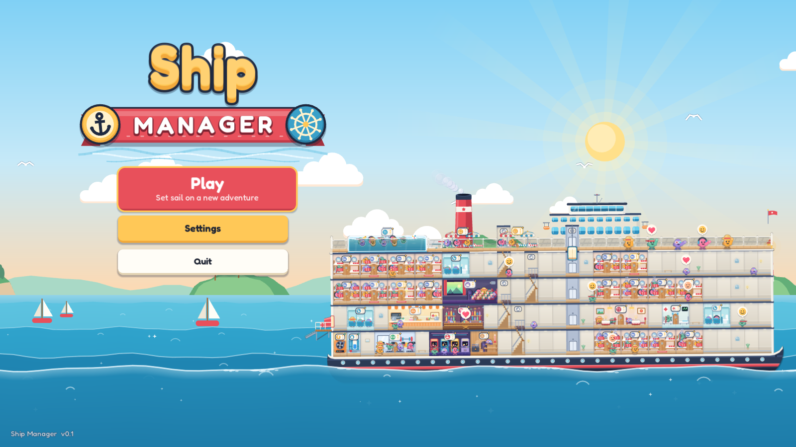

# Ship Manager

A cute 2D side-view ship management game made in Godot. Build your ship in port, then survive a
hectic voyage keeping guests fed, entertained, clean and happy.



**Play in your browser:** https://vabs.github.io/shipy/

## How to run locally

1. Install Godot 4.7 or newer: download it from [godotengine.org](https://godotengine.org/download),
   or on macOS run `brew install --cask godot`.
2. From the project folder, start the game:

   ```bash
   godot --path .
   ```

   Or open the project in the Godot editor (`godot -e --path .`) and press **F5**.
